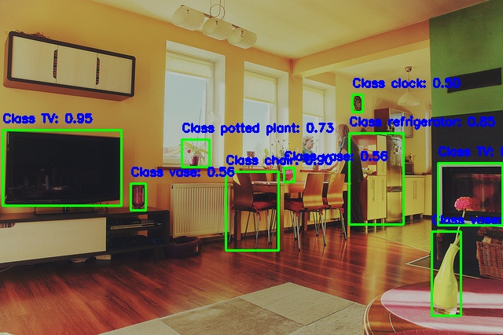

<table class="sphinxhide" width="100%">
 <tr width="100%">
    <td align="center"><h1> Ryzen™ AI Object Detection with Yolov8m </h1>
    </td>
 </tr>
</table>

# Introduction

In this tutorial we deploy a YOLOv8m object detector on the Ryzen AI NPU. There are three ways to compile it:

1. **Quark XINT8 mixed precision.** Quark quantizes the graph to INT8 and leaves the detection head out of that quantization. `--device npu-int8` runs it with the Vitis AI provider and cache options only. No VAIML config JSON is loaded.
2. **Quark BF16.** Quark writes a BF16 ONNX model. Compile and run that file with `vaiml_config_quark.json`. That config does not set a float-conversion flag.
3. **BF16 compile of the FP32 model.** Compile `models/yolov8m.onnx` with `vaiml_config_bf16.json` (`enable_f32_to_bf16_conversion`).

The NPU cache directory is `modelcachekey_<datatype>` when VAIML converts the FP32 model, and `modelcachekey_<datatype>_quark` when Quark quantized the model.

## Overview

- Export `yolov8m.pt` to ONNX (opset 17)
- Option A: Quark `XINT8`, then run with `--device npu-int8` and no config JSON
- Option B: Quark `BF16`, then compile and run with `vaiml_config_quark.json`
- Option C: compile and run the FP32 ONNX with `vaiml_config_bf16.json`

## Environment

`requirements.txt` only adds `pycocotools`, `wget`, and `onnxsim`. It does not install `torch`, `numpy`, `opencv`, or `ultralytics`, because replacing the builds already in the Ryzen AI environment breaks the NPU stack.

### Windows

```bat
set RYZEN_AI_CONDA_ENV_NAME=ryzen-ai-<version>
conda activate %RYZEN_AI_CONDA_ENV_NAME%
```

### Linux

Activate the installer venv first. That sets `RYZEN_AI_INSTALLATION_PATH` to the venv directory. Then load XRT, which adds the NPU libraries to `LD_LIBRARY_PATH`. This is the order in the [Linux installation instructions](https://ryzenai.docs.amd.com/en/latest/linux.html).

```sh
source <Ryzen-AI-install>/venv/bin/activate
source /opt/xilinx/xrt/setup.sh
```

From the example directory, on either operating system:

```bash
cd <RyzenAI-SW>/CNN-examples/object_detection/yolov8m
python -m pip install -r requirements.txt
```

## Download and export the model

Download [yolov8m.pt](https://github.com/ultralytics/assets/releases/download/v8.3.0/yolov8m.pt) into `models/`. The export script reads it from that directory.

```bash
cd models
python export_to_onnx.py
cd ..
```

## Option A: Quark XINT8 mixed precision, run without a config JSON

Quark `XINT8` is the same configuration used by `CNN-examples/torchvision_inference`: `get_default_config("XINT8")`. Activations are UINT8 and weights are INT8. `BF16QDQToCast` is not set. The detection head stays out of that quantization, so this is the mixed-precision path: INT8 for the backbone, and the head left in floating point.

Quantizing the whole graph, including the head that concatenates boxes and class scores, drops detections. Exclude that subgraph. In `models/yolov8m.onnx` it starts at `/model.22/Concat_3` and ends at `/model.22/Concat_10`. There is no `/model.22/Concat_5` in this file.

```bash
python quantize_quark.py --input_model_path models/yolov8m.onnx \
                         --calib_data_path calib_images \
                         --output_model_path models/yolov8m_XINT8.onnx \
                         --config XINT8 \
                         --exclude_subgraphs "[/model.22/Concat_3], [/model.22/Concat_10]"
```

Run it on `test_image.jpg`. `--device npu-int8` passes cache options only. It does not load a VAIML config JSON.

```bash
python run_inference.py --model_input models/yolov8m_XINT8.onnx --input_image test_image.jpg --output_image test_output_int8.jpg --device npu-int8
```

The cache is `modelcachekey_xint8_quark/`. The run writes `test_output_int8.jpg`.



## Option B: Quark BF16, compile and run with the Quark config

Quantize the FP32 ONNX model with Quark. `--config BF16` also sets `BF16QDQToCast`. When `--config_file` is `vaiml_config_quark.json`, `run_inference.py` registers Quark's custom-op library.

```bash
python quantize_quark.py --input_model_path models/yolov8m.onnx \
                         --calib_data_path calib_images \
                         --output_model_path models/yolov8m_BF16.onnx \
                         --config BF16
```

Compile and run with `vaiml_config_quark.json`. That file sets `optimize_level` and `keep_outputs`. It does not cast the graph, because the ONNX model is already BF16.

```bash
python run_inference.py --model_input models/yolov8m_BF16.onnx --input_image test_image.jpg --output_image test_output_bf16_quark.jpg --device npu-bf16 --config_file vaiml_config_quark.json
```

The cache is `modelcachekey_bf16_quark/`.

## Option C: Compile and run the FP32 model with the BF16 config

This path does not quantize with Quark. `--device npu-bf16` loads `vaiml_config_bf16.json` when `--config_file` is omitted. That file sets `enable_f32_to_bf16_conversion` to true. VAIML casts `models/yolov8m.onnx` to BFloat16 while compiling it for the NPU.

```bash
python run_inference.py --model_input models/yolov8m.onnx --input_image test_image.jpg --output_image test_output_bf16.jpg --device npu-bf16 --config_file vaiml_config_bf16.json
```

On the first run, VAIML compiles the model for the NPU. That compile takes several minutes. The cache is `modelcachekey_bf16/` and is reused on later runs. The run writes `test_output_bf16.jpg`.

Measured on Ryzen AI 1.9.0rc, Linux, Strix NPU (`stx`, overlay `rai_2x4x4.json`). The input is the float32 model: 307 operators, 82.3149 GOPs. VAIML reports device data type `bfloat16`. `modelcachekey_bf16/final-vaiml-pass-summary.txt` records:

| | Result |
|---|---|
| Operators supported and offloaded | 307 of 307 (100%) |
| GOPs supported and offloaded | 82.315 of 82.3149 (100%) |
| NPU partitions | 1 |
| CPU partitions | 0 |
| BF16 ops in the offloaded subgraph | 96.014% |
| AIE compiler | 0 errors (184 warnings) |
| Compile time | 738.8 s |

The runtime log reports `VAIML 307`, one NPU subgraph, and `Actually running on NPU 1`.

## Evaluate the model accuracy

Use the `prepare_data.py` script to download the COCO dataset

```bash
python prepare_data.py
```

Evaluate the accuracy of the model on COCO dataset. Use `--device` options `cpu`, `npu-int8`, or `npu-bf16` to measure accuracy metrics on CPU/NPU respectively.

```bash
python run_inference.py --model_input models/yolov8m_XINT8.onnx --evaluate --coco_dataset datasets/coco --device npu-int8
python run_inference.py --model_input models/yolov8m.onnx --evaluate --coco_dataset datasets/coco --device npu-bf16 --config_file vaiml_config_bf16.json
```

<div align="center">

|  Yolov8m      | mAP (AP@[IoU=0.50:0.95]) |  mAP50 (AP@IoU=0.50) |  mAP75 (AP@IoU=0.75) |
|---------------|--------------------------|----------------------|----------------------|
| Float 32      |       44.0               |     57.4             |      47.9            |
| XINT8 (CPU)   |       38.2               |     52.3             |      41.8            |
| XINT8 (NPU)   |       38.1               |     52.2             |      41.6            |


</div>


## Evaluate the Model Performance across formats

Evaluate the Performance of Model across Float32 (CPU), BF16 and XINT8. Model is benchmarked across 100 inference runs and we measure  
1) Latency - Average time for each Inference run on CPU/NPU
2) Frames per Second - Indicates how many individual images, or frames, are inferred per second 

Use `--benchmark` option while running the Model

```bash
python run_inference.py --model_input models/yolov8m.onnx --input_image test_image.jpg --output_image test_output_bf16.jpg --device npu-bf16 --config_file vaiml_config_bf16.json --benchmark
python run_inference.py --model_input models/yolov8m_XINT8.onnx --input_image test_image.jpg --output_image test_output_int8.jpg --device npu-int8 --benchmark
```


<div align="center">

|  Yolov8m      | Avg time for each Inference (Latency) |  Frames per Second (FPS)| 
|---------------|---------------------------------------|-------------------------|
| Float32 (CPU) |       0.154 sec                       |     6.5                 |
| BF16    (NPU) |       0.029 sec                       |     34.1                |
| XINT8   (NPU) |       0.026 sec                       |     37.8                |

</div>
